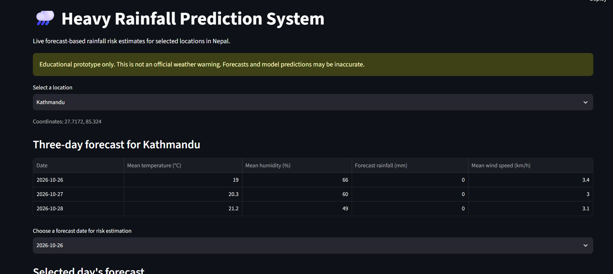

# Heavy Rainfall Prediction System for Nepal

**Live Demo:** [Try the Nepal Heavy Rainfall Prediction App](https://nepal-heavy-rainfall-prediction-5tpm8lakdcsdqmlh469zpn.streamlit.app/)

A machine learning application that predicts rainfall amounts and identifies heavy-rainfall risk across six locations in Nepal.

## Overview

This project estimates the risk of heavy rainfall for six locations in Nepal using a machine-learning model and live weather forecasts.

The application displays forecast weather conditions and uses a trained Random Forest classifier to estimate the probability of heavy rainfall.

## Application Preview



## Locations

- Kathmandu
- Pokhara
- Biratnagar
- Janakpur
- Jumla
- Nepalgunj

## Technologies Used

- Python
- Pandas
- Scikit-learn
- Streamlit
- Open-Meteo API
- Joblib

## Features

- Select a location in Nepal.
- View a three-day weather forecast.
- Select a forecast date.
- Estimate heavy-rainfall risk using a trained machine-learning model.
- Display forecast temperature, humidity, rainfall, and wind speed.

## Installation

Clone or download this repository and open the project folder in PowerShell.

Create a virtual environment:

```powershell
python -m venv venv
```

Activate the virtual environment:

```powershell
.\venv\Scripts\Activate.ps1
```

Install the required dependencies:

```powershell
python -m pip install -r requirements.txt
```

## Run the Application

Start the Streamlit application:

```powershell
python -m streamlit run app.py
```

Open the local URL displayed in the terminal, usually `http://localhost:8501`.


## Model and Data

The project includes a saved Random Forest classifier and feature names in the `models/` directory. The training data combines archived weather forecasts with historical rainfall labels.

Heavy rainfall is defined as daily rainfall of at least 50 mm.

## Limitations

- This is an educational project, not an official weather warning system.
- Model performance is limited by the small number of heavy-rainfall events in the training data.
- The live forecast source may differ from the archived forecasts used to train the model.
- Predicted probabilities may not be well calibrated and should not be interpreted as guarantees.
- Forecast and historical rainfall datasets can disagree.
- Predictions should not be used alone for safety-critical decisions.

## Future Improvements

- Evaluate forecasts against reliable local rain-gauge observations.
- Improve heavy-rainfall detection and probability calibration.
- Compare different forecasting models.
- Add more locations and longer-term evaluation.
- Deploy the application online.

## Disclaimer

This project is for educational and research purposes only. Consult official weather forecasts and warnings from the relevant meteorological authorities for safety decisions.
